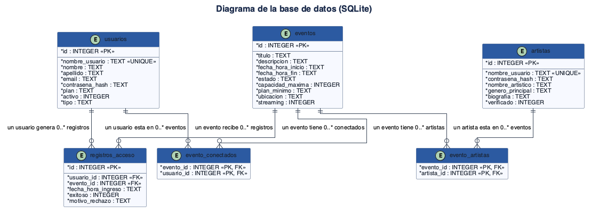
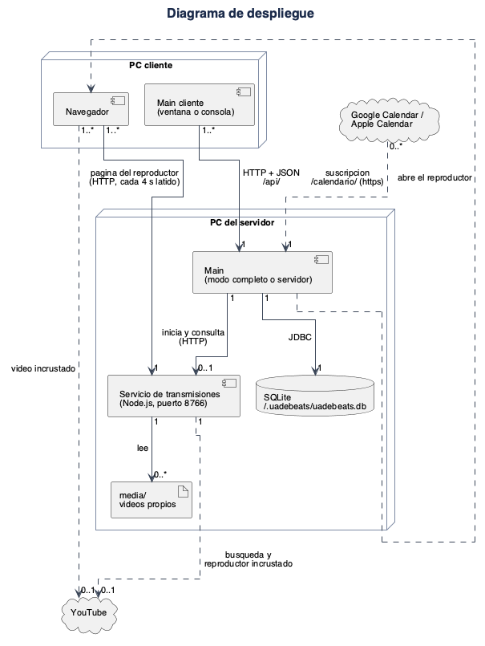
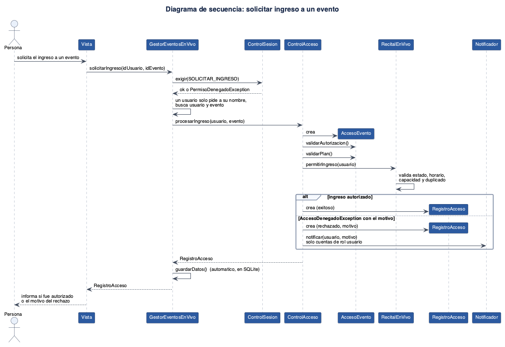
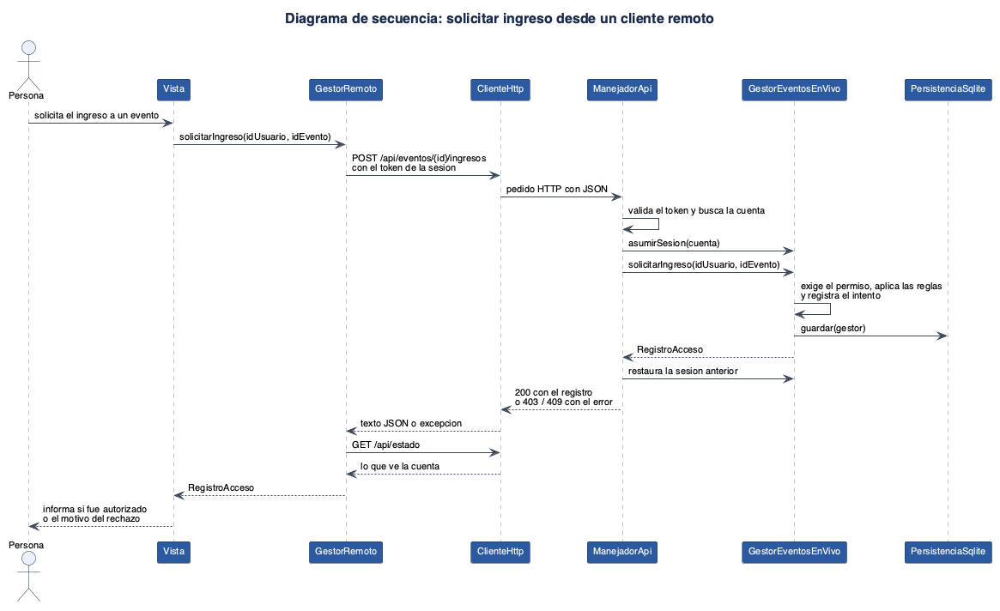

# UADE Beats - Entrega final

Proceso de Desarrollo de Software (3.4.210) - Martes mañana - 2C 2026
Grupo 10: Franco Beron y Leandro Ferraro

## Qué es

UADE Beats es un sistema para gestionar recitales en vivo. Hay tres roles:

- El administrador da de alta usuarios y artistas, maneja los eventos y puede expulsar gente.
- El artista crea sus eventos, los inicia, los pausa y los termina.
- El usuario pide entrar a un evento. El sistema lo deja pasar o no según su plan (Free, Premium o Artist Pass), el estado del evento, el horario y la capacidad.

Todos los intentos de ingreso, los que entran y los rechazados, quedan registrados. Los datos se guardan en una base SQLite. Además se puede usar desde otra PC conectándose a un servidor, suscribir un evento a Google Calendar o Apple Calendar y ver la transmisión de un evento que está en curso.

Partimos de un TP que teníamos de POO (la versión 0) y lo fuimos mejorando a lo largo de la cursada. Cada etapa quedó en su rama: `iteracion-0` (el TP de POO), de `iteracion-1` a `iteracion-4` e `iteracion-final`. Esta rama, `main`, tiene la versión que entregamos.

## Estructura del repositorio

| Carpeta | Contenido |
|---|---|
| `TP/Grupo9_POO_EntregaFinal/Codigo` | El programa en Java: `src` con el código, `test` con las pruebas y `lib` con los jar de SQLite y Gson |
| `TP/Grupo9_Servicio_Transmision` | El servicio de transmisiones en Node.js |
| `Diagramas` | Los diagramas de la entrega en PDF y, en `imagenes`, las vistas previas que se muestran en este README |

## Cómo lo corremos

Hace falta Java 17 o más nuevo. Desde `TP/Grupo9_POO_EntregaFinal/Codigo`, en PowerShell:

```
javac -encoding UTF-8 -cp "lib/*" -d out (Get-ChildItem -Recurse src,test -Filter *.java).FullName
java --enable-native-access=ALL-UNNAMED -cp "out;lib/*" Main
```

En Mac o Linux es así:

```
javac -encoding UTF-8 -cp "lib/*" -d out $(find src test -name "*.java")
java --enable-native-access=ALL-UNNAMED -cp "out:lib/*" Main
```

También se puede abrir la carpeta `Codigo` en IntelliJ, agregar `lib` como librería y correr `Main`.

Al arrancar, el programa pregunta si queremos la ventana o la consola y después pide usuario y contraseña. La base se crea sola la primera vez, con datos de prueba.

Algunas cuentas para probar:

- `admin` / `admin123`: administrador
- `lferraro` / `lferraro2024`: usuario
- `bandahorizonte` / `horizonte2024`: artista

Para probar los ingresos y la transmisión está el evento 106, que está en curso todo el tiempo. La transmisión necesita Node instalado. Los otros eventos sirven para ver los rechazos: el 100 figura en curso pero su horario ya pasó, el 102 está pausado y el 105 está cancelado.

Las pruebas están en `test/PruebasIteracion4.java` y se compilan junto con el resto con los comandos de arriba. Se corren con `java -cp "out;lib/*" PruebasIteracion4` (en Mac o Linux, `out:lib/*`): hace 110 comprobaciones y al final tiene que decir OK.

### Modos de arranque

| Modo | Comando | Qué hace |
|---|---|---|
| Completo | `Main` | Datos propios en SQLite, ventana o consola, y la API y los calendarios para otros equipos. |
| Servidor | `Main servidor` | Solo los datos y la API, sin interfaz. Se deja corriendo en una PC y acepta conexiones de la red. |
| Cliente | `Main cliente http://IP:8765` | Solo la interfaz. No guarda nada: se conecta al servidor, inicia sesión ahí y trabaja con lo que su rol puede ver. |

Para usar el cliente desde otra PC, el servidor tiene que aceptar conexiones de la red (modo `servidor`) y el puerto tiene que estar abierto en el firewall. Los parámetros se pasan como propiedades de Java (`-D`):

| Propiedad | Valor por defecto | Uso |
|---|---|---|
| `uadebeats.db` | `~/.uadebeats/uadebeats.db` | Archivo de la base SQLite |
| `uadebeats.puerto` | `8765` | Puerto de la API |
| `uadebeats.escuchar` | `local` en modo completo, `todas` en modo servidor | `todas` acepta conexiones de la red |
| `uadebeats.puerto.calendario` | `8767` | Puerto con el que el modo completo publica los calendarios en la red local |
| `uadebeats.url` | (ninguna) | Dirección pública con https del servidor, para los calendarios |
| `uadebeats.servidor` | (ninguna) | Dirección del servidor para el modo cliente, si no se pasa como argumento |
| `uadebeats.transmision` | `http://localhost:8766` | Dirección del servicio de transmisiones |

## Cómo fue cambiando el proyecto

**Versión 0.** El TP de POO como estaba: una clase `App` de casi mil líneas con todo adentro, `Usuario` y `Artista` con los mismos datos repetidos y la persistencia en archivos de texto.

**Iteración 1 - Bad smells.** Creamos la clase `Cuenta` como base de `Usuario` y `Artista`. Partimos la God Class `App` en `ConsoleIO`, `DatosIniciales` y `MenuAcciones`. Agrupamos los 11 parámetros del constructor del recital en `DatosRecital`. También sacamos código duplicado y partimos métodos largos.

**Iteración 2 - GRASP.** Ordenamos quién hace qué. Cada validación quedó en la clase que tiene los datos: `AccesoEvento` valida la autorización y el plan, y `RecitalEnVivo` valida el estado, el horario y la capacidad. El gestor quedó como controlador y las pantallas dejaron de llamar directamente a los métodos de `Evento`. Borramos los métodos que no hacían nada y sacamos los `System.out` del modelo.

**Iteración 3 - SOLID y MVC.** Separamos los ingresos en `ControlAcceso` (responsabilidad única). Sacamos los `instanceof RecitalEnVivo` para que cualquier tipo de `Evento` sirva (abierto/cerrado y Liskov). El gestor pasó a depender de la interfaz `Persistencia` y no de la clase concreta (inversión de dependencias). Separamos modelo, vista y controlador, y agregamos los roles con sus permisos y la ventana de login.

**Iteración 4.** Pasamos de los TXT a SQLite, con un repositorio por tabla. Agregamos el servidor con API HTTP y el modo cliente. Las contraseñas pasaron a guardarse con hash. Sumamos la suscripción a calendarios y el servicio de transmisiones. Las vistas pasaron a depender de la interfaz `ServicioEventos`, así les da lo mismo usar el gestor local o el remoto. Para lo que ve cada rol usamos el patrón Strategy (`PoliticasVisibilidad`).

**Iteración final.** Rehicimos el diagrama de clases con las correcciones que nos marcaron:

- todas las relaciones tienen nombre;
- las interfaces se dibujan punteadas, con triángulo y sin cardinalidad;
- solo es asociación cuando hay un atributo, y lo que se crea o se usa dentro de un método es dependencia;
- las flechas van en el sentido correcto;
- agregamos las relaciones que faltaban.

También rehicimos los diagramas GRASP sobre el código actual. En el código hicimos tres cambios chicos: sacamos el atributo `exclusivo` de los eventos, que no se usaba; los eventos sin video propio ahora usan el video de demostración; y el administrador ya no puede solicitar ingresos, porque no tiene sentido que entre a un recital.

## Patrones que usamos

| Patrón | Dónde | Para qué |
|---|---|---|
| GRASP | Experto en información, creador, controlador, bajo acoplamiento y alta cohesión | Repartir las responsabilidades. Los diagramas de cada uno están en [Diagramas GRASP.pdf](Diagramas/Diagramas%20GRASP.pdf) |
| SOLID | Los cinco, como se cuenta en la iteración 3 | Que agregar algo nuevo no obligue a tocar lo que ya funciona |
| MVC | Modelo, vistas (ventana y consola) y controlador (`GestorEventosEnVivo`) | Que la lógica no dependa de cómo se muestra |
| Strategy | `PoliticasVisibilidad`, con `VisibilidadGeneral` y `VisibilidadArtista` | Decidir qué eventos ve cada rol sin `if` por rol en el gestor |
| Repository | Uno por tabla: `RepositorioUsuarios`, `RepositorioArtistas`, `RepositorioEventos` y `RepositorioRegistros` | Que el resto del programa no conozca SQL |
| Proxy remoto | `GestorRemoto` | Implementa `ServicioEventos` igual que el gestor local y reenvía cada pedido al servidor |
| DTO | Paquete `api` | Los datos que viajan por la red, ya filtrados por rol y sin contraseñas |

### Paquetes

| Paquete | Contenido |
|---|---|
| `modelo` | Entidades y reglas de negocio |
| `gestor` | `GestorEventosEnVivo`, `ControlAcceso`, `ControlTransmision` y las políticas de visibilidad |
| `servicio` | Las interfaces que usan las vistas: `ServicioEventos` y sus tres partes |
| `seguridad` | `ControlSesion`, `Permisos` y `Accion` |
| `puertos` | Las interfaces que recibe el gestor (`Persistencia`, `Notificador`, `PublicadorCalendario`, `ProveedorTransmision`, `VinculoCalendario`) |
| `persistencia`, `notificacion`, `calendario`, `transmision` | Las implementaciones de esos puertos |
| `servidor`, `api`, `cliente` | La API HTTP, sus DTO y el cliente remoto |
| `app` | Arranque y datos de prueba |
| `consola` | Menús de consola |
| `ui` | Ventanas Swing, sus formularios y el logo |

## Roles y permisos

| Acción | Usuario | Artista | Administrador |
|---|---|---|---|
| Solicitar ingreso a un evento | Sí | No | No |
| Ver eventos | Todos | Solo los propios | Todos |
| Agregar un evento a mi calendario | Sí | Solo los propios | Sí |
| Ver la transmisión de un evento en curso | Solo si ingresó | Solo los propios | Sí |
| Ver sus registros de acceso | Sí | No | No |
| Crear un evento | No | A su nombre | Sí |
| Iniciar, pausar, reanudar, finalizar y cancelar un evento | No | Solo los propios | Cualquiera |
| Ver los usuarios conectados | No | Solo los propios | Sí |
| Registrar usuarios y artistas, activarlos o desactivarlos | No | No | Sí |
| Expulsar a un usuario | No | No | Sí |
| Ver todos los registros | No | No | Sí |

## Base de datos

Un archivo SQLite con seis tablas y las claves foráneas activadas. Las contraseñas se guardan como hash PBKDF2 con sal por cuenta, nunca en texto plano.

| Tabla | Contenido |
|---|---|
| `usuarios` | Usuarios y administrador: cuenta, nombre, apellido, email, hash de la contraseña, plan, activo y rol |
| `artistas` | Cuenta, hash de la contraseña, nombre artístico, género, biografía y verificado |
| `eventos` | Título, descripción, inicio, fin, estado, capacidad, plan mínimo, ubicación y streaming |
| `evento_artistas` | Artistas de cada evento |
| `evento_conectados` | Usuarios conectados a cada evento |
| `registros_acceso` | Usuario, evento, fecha, resultado y motivo del rechazo |

Si la base está vacía, el programa carga ocho usuarios, cinco artistas, siete eventos en distintos estados y dieciséis accesos:

| Evento | Estado | Plan mínimo |
|---|---|---|
| 100 Rock en Vivo | En curso, con el horario vencido | Premium |
| 101 Backstage Prisma Live | En espera | Artist Pass |
| 102 Noche de Folklore | Pausado | Free |
| 103 Luna en Vivo (Acústico) | Programado | Free |
| 104 Festival de Verano 2025 | Finalizado | Free |
| 105 Fiesta Electrónica Cancelada | Cancelado | Premium |
| 106 Sunrust - Transmisión permanente | En curso hasta 2099 | Free |

## Calendarios y transmisiones

**Calendarios.** Se elige un evento y se toca Google Calendar o Apple Calendar. Se abre el navegador o la app Calendario con la suscripción armada, y desde entonces el evento se mantiene al día: si cambia el horario aparece el cambio y si se cancela queda marcado. El programa publica cada evento en `/calendario/<código>/<id>.ics`, donde el código es un HMAC de la cuenta, así que no se puede adivinar. Google Calendar necesita una dirección https (un túnel de Cloudflare con `cloudflared` o `-Duadebeats.url`); para Apple Calendar, si no hay túnel, el programa usa la dirección de la red local.

**Transmisiones.** El servicio de `TP/Grupo9_Servicio_Transmision` muestra el recital del artista a pantalla completa, como si fuera en vivo: arranca en el minuto que corresponde según cuándo empezó el evento y no deja pausar ni adelantar. Usa un video propio de la carpeta `media/` o un recital de YouTube que se pueda incrustar, y los eventos sin video propio usan el de demostración, que se baja con `descargar-demo.sh`. El programa arranca el servicio solo y lo cierra al salir. Un usuario ve la transmisión cuando ingresa a un evento en curso; artistas y administrador la abren con el botón «Ver transmisión».

## Diagramas

Los PDF de la entrega están en la carpeta [`Diagramas`](Diagramas):

| Diagrama | Contenido |
|---|---|
| [Diagrama de clases](Diagramas/Diagrama%20de%20clases.pdf) | Todas las clases e interfaces agrupadas por paquete, con atributos, métodos, relaciones con nombre y cardinalidades. También en [SVG](Diagramas/Diagrama%20de%20clases.svg) para hacer zoom |
| [Diagramas GRASP](Diagramas/Diagramas%20GRASP.pdf) | Un diagrama por cada patrón GRASP, sobre el código actual |
| [Diagrama de secuencia](Diagramas/Diagrama%20de%20secuencia.pdf) | Solicitar ingreso con el gestor local, desde un cliente remoto y ver la transmisión de un evento |
| [Diagrama de base de datos](Diagramas/Diagrama%20de%20base%20de%20datos.pdf) | Las seis tablas con claves primarias y foráneas y cardinalidades |
| [Diagrama de despliegue](Diagramas/Diagrama%20de%20despliegue.pdf) | Qué corre en la PC del servidor y en la PC cliente, y cómo se conectan |

En el diagrama de clases cada relación lleva su nombre y, si es una asociación, su multiplicidad en cada extremo. Usamos composición (rombo lleno) cuando el objeto no existe sin su dueño, agregación (rombo vacío) para las colecciones, línea llena con flecha para las asociaciones de un solo sentido, línea llena sin flechas para la única bidireccional (`Evento` ↔ `Artista`), punteada para las dependencias, triángulo hueco para la herencia y punteada con triángulo y «implementa», sin cardinalidad, para las interfaces.

### Diagrama de clases


### Diagrama de base de datos



### Diagrama de despliegue



### Diagramas de secuencia

La tercera página, ver la transmisión de un evento, está en el [PDF](Diagramas/Diagrama%20de%20secuencia.pdf).





## Limitaciones conocidas

| Limitación | Detalle |
|---|---|
| Conexión sin cifrar | La API usa HTTP. Fuera de una red de confianza conviene exponerla con un túnel https, porque al iniciar sesión la contraseña viaja una vez. |
| Base anterior | Una base creada por una versión vieja puede no ser compatible: se borra `~/.uadebeats/uadebeats.db` y se vuelve a crear con los datos de prueba. |
| Sesiones | Viven en memoria y no vencen por tiempo. |
| Transmisiones | Sin clave de la API, el servicio lee la página de resultados de YouTube, que no es una API estable, y muchos recitales no permiten reproducirse fuera de YouTube. |
| Fin del evento | `fechaHoraFin` es la ventana en la que se permite ingresar y no la duración real del recital. Viene del diseño original del modelo. |
